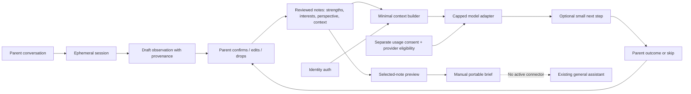
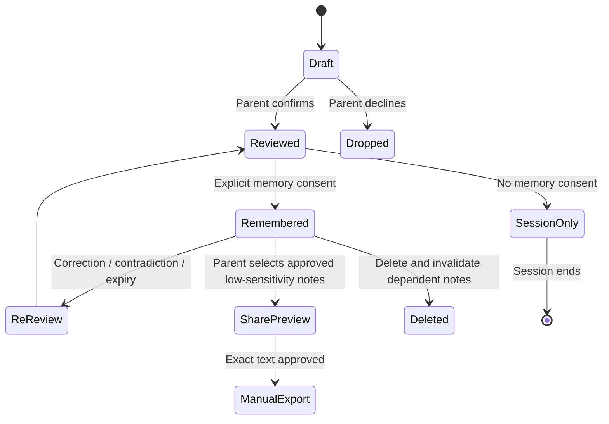
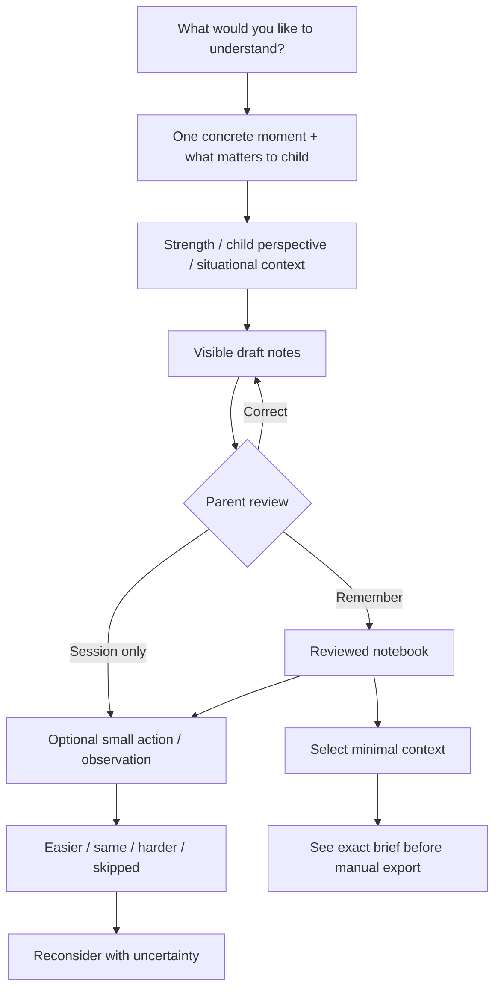

# Proposed architecture and UX boundaries

Proposed new product, not the existing production system. The prototype implements only memory-in-tab UI, deterministic rules and filtered synthetic JSON export. See code-audit.md for existing mechanisms and profile-safety.md for a fuller proposed lifecycle.

Real build boundaries: stable family/child/note IDs; server-side family authorization; separate draft/inference/confirmed records; versioned consent; source-based expiry and contradictions; encrypted store; no raw chat in analytics; tombstones to prevent deleted notes being re-extracted; deletion cascade plus cache/checkpoint/snapshot verification. Parent-only first. Direct child interaction requires separate adult-auth and session isolation, not merely hiding parent screens.

A data graph is justified only if it beats a short reviewed summary on task utility, safety and burden. Minimize first.
