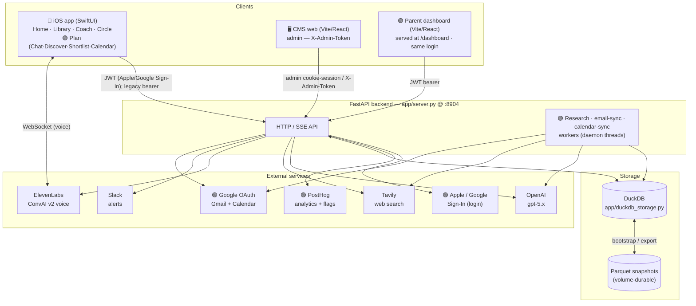
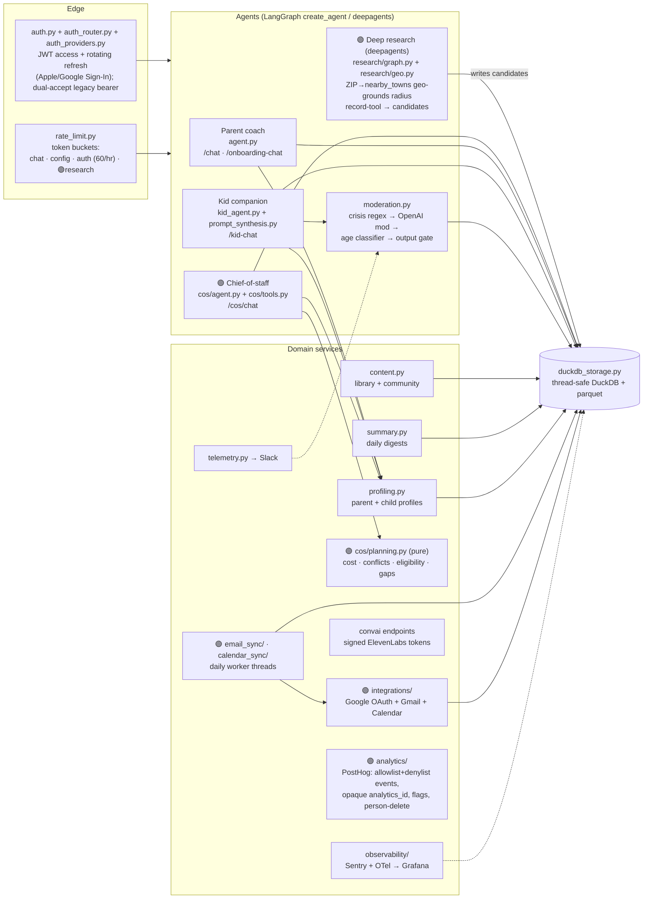
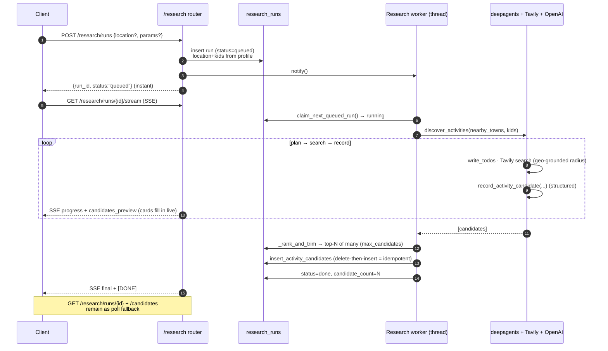
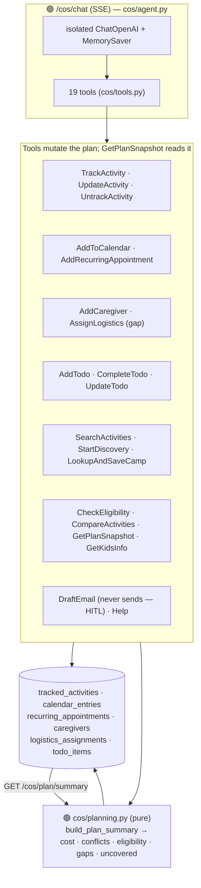
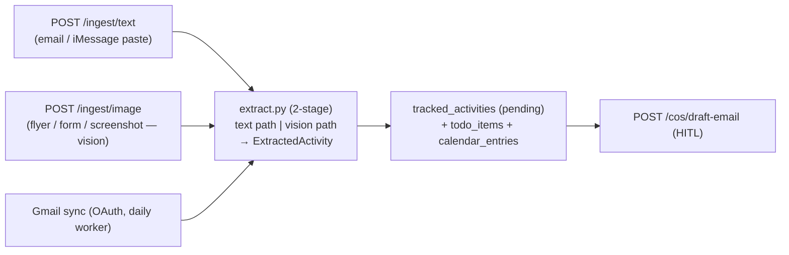
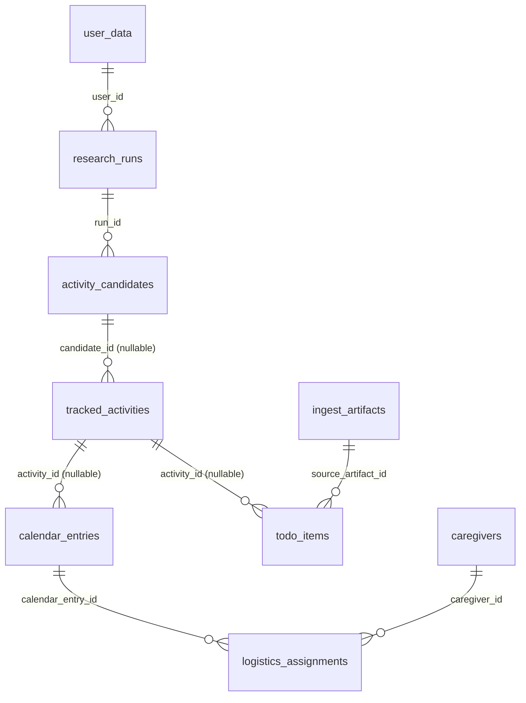

# MVP — System Architecture

A parenting app with four AI agents (parent coach, kid companion, **chief-of-staff**,
and a **deep-research** background agent), a content library, and ElevenLabs voice.
Backend is FastAPI + LangGraph + DuckDB; clients are a SwiftUI iOS app and React web apps.

> **Legend:** 🟢 = activity-planning / chief-of-staff capability (shipped 2026, deployed to
> prod; iOS ships via TestFlight). It's the newest surface — the marker just flags it.

---

## 1. System context



---

## 2. Backend internals — agents, services, storage



**Agent isolation:** the coach, kid, and chief-of-staff agents each have their **own**
`ChatOpenAI`, checkpointer, and per-user cache — no shared state, so a regression in one
can't affect the others. The research agent is `deepagents` (planning + sub-agents +
filesystem harness) with an explicit OpenAI model (deepagents defaults to Anthropic).

---

## 3. 🟢 Activity-planning capability (the new flow)

Two cooperating pieces: a **background research agent** that discovers activities, and an
interactive **chief-of-staff** agent that turns discoveries into a coordinated plan.

### 3a. Discovery — research run lifecycle (SSE-streaming, live partials)



Live results: the client opens `GET /research/runs/{id}/stream` and the SSE tails
`progress_json` + `candidates_preview`, so the UI renders skeleton→cards as they land (the
old poll endpoints stay as fallback). The surfaced count is the parent's chosen
`max_candidates` — `_rank_and_trim` keeps the top-N of many. The radius is **geo-grounded**:
`research/geo.py` resolves the ZIP against a bundled US ZIP-centroid dataset and enumerates
the actual `nearby_towns` injected into the prompt, so "within N miles" is honored.

Durability: the `research_runs` row **is** the job (the phone never holds it). On restart a
startup sweeper re-queues anything left `running`; re-runs are idempotent.

### 3b. Coordination — chief-of-staff



`GET /cos/plan/summary` returns the workbook's derived intelligence: running **cost** tally
(confirmed vs TBD), **time conflicts** (camp hours vs therapy), **age-eligibility** flags,
caregiver **coverage gaps**, and **uncovered weeks**.

**Activity lifecycle board (`GET /cos/plan/board`, single source of truth `app/cos/lifecycle.py`).**
Every tracked activity sits in one of 4 stages — Considering → To register (`planned`) →
Registered · needs action → All set — with register/pay surfaced as next-**actions** via typed
to-dos. A register hook (instant email-sync + seeded typed to-dos) fires at every WATCHED entry,
including chat tools. `POST /cos/plan/reset` starts over; pass-anywhere + delete-forever
(cascade) are supported. Drives both the iOS Plan tab and the web dashboard.

**Export + share (Phase 3b, LIVE).** `GET /cos/plan/export.xlsx` regenerates the workbook-style
spreadsheet (openpyxl); scoped, read-only, expiring **share links** (`issue_share_token`) let a
nanny/therapist see a filtered slice without an account.

### 3c. Multimodal ingestion → plan



### 3d. 🟢 Verticals + registration watchlist (2026-07-11, `docs/history/009.md`)

The COS spans **five verticals behind one agent** — camps, extracurriculars, outings,
school events, trips. Architecture rules (critic-hardened, binding):

- **Verticals are DATA, not agents/navigation.** `app/cos/verticals.py` holds a frozen
  `VerticalProfile` registry (date model, capability booleans, to-do wording, door copy,
  research focus). ONE static sectioned system prompt in `agent.py`; conditionals stay in
  code (`lifecycle.py`); a vertical is a card attribute + chip filter on both clients.
- **Feature flags touch verticals in exactly one place:** `GET /cos/verticals` filters
  DOOR visibility (fail-open to unflagged doors; clients cache last-good). The
  lifecycle/planning/agent engine never branches on a flag.
- **Dates:** `storage.set_activity_dates` is the single write path — week_block derives
  `week_start`, RFC-5545 `rrule` is the source of truth for recurring (the derived
  `recurring_appointments` row regenerates, never hand-edited), single_date/date_range
  for school events/trips. `lifecycle.format_when` renders the ONE `when` string both
  clients show verbatim.
- **Registration watchlist** (`app/watchlist/`) is engineered as a notification SLO:
  `registration_windows` + an append-only `window_notifications` delivery log (the
  `(window_id, kind, opens_at_snapshot)` NOT-EXISTS due-check gives idempotency,
  re-arm-on-date-change, and an audit trail in one mechanism); tz-aware
  notify-before-never-after due rules; a catch-up sweep worker (repairs downtime within
  one poll); durable-first delivery (log row + fallback to-do in one txn → blocking APNs
  `push.send_push` → recorded outcome). Miss detector + heartbeat gauges feed the
  Grafana "Watchlist SLO" row and its alert rules.
- **Prompt-diff gate:** any change to the COS prompt or a tool docstring must re-run the
  golden set (`tests/goldens/`, live tool-selection eval vs gpt-5.5) and hold baseline.
- **Public docs** ship in the dashboard bundle at `/dashboard/docs` (outside the auth
  guard), one page per vertical, enforced by `tests/test_public_docs.py`.

---

## 4. Data model (DuckDB)

All tables bootstrap from parquet snapshots on startup and export back on writes/shutdown.
Schema migrations run in order on boot, each body + version stamp in one transaction
(`app/migrations.py`, v19 as of 2026-07-11 — note: an index on a backfilled column must
live in its OWN migration; DuckDB can't CREATE INDEX in a transaction that UPDATEd the
table, and only a populated DB exposes it). User-state parquets are excluded from the
Docker build context (guarded by `tests/test_dockerignore_guard.py`; prod keeps its own
volume copy).



| Domain | Tables |
|---|---|
| Core / auth | `user_data`, `user_accounts`, `auth_identities`, `refresh_tokens`, `auth_tokens` (legacy), `consent_records`, `audit_events` |
| Content | `categories`, `articles`, `community_posts`, `post_replies` |
| Kid companion | `kid_agent_configs`, `kid_messages`, `kid_credentials`, `moderation_events`, `kid_agent_crisis_locks`, `daily_summaries` |
| 🟢 Discovery | `research_runs`, `activity_candidates` (+ `city`, `region`, `distance_mi` — v8/v9) |
| 🟢 Coordination | `tracked_activities` (+ `activity_type` v16, dates/rrule v17), `calendar_entries`, `recurring_appointments`, `caregivers`, `logistics_assignments`, `todo_items`, `cos_messages` |
| 🟢 Watchlist | `registration_windows`, `window_notifications` (append-only delivery log) |
| 🟢 Ingestion | `ingest_artifacts` |
| 🟢 Integrations / sync | `integration_accounts` (was `google_oauth_tokens` — generalized in R5), `email_sync_runs`, `calendar_sync_runs`, `agent_config` |

---

## 5. Cross-cutting

- **Auth (v2, LIVE):** native Apple + Google Sign-In → JWT HS256 access tokens (30-min) +
  rotating refresh tokens with reuse-detection (`user_accounts`/`auth_identities`/`refresh_tokens`).
  `current_user` **dual-accepts** JWT (no-DB path) or a legacy opaque token (gated by
  `AUTH_LEGACY_TOKENS_ENABLED`); `has_profile` routes returning users straight past onboarding;
  legacy accounts claim their data on first sign-in (admin safety net for lost tokens).
  `/auth/issue-token` is gated (`AUTH_ISSUE_TOKEN_ENABLED`) and refuses claimed accounts — it
  retires at T2. `authorize_user_match` still blocks cross-user access (404, not 403) on every write.
- **Analytics & flags:** PostHog (`app/analytics/`, env-gated no-op) — strict event allowlist +
  PII denylist, distinct_id = opaque `analytics_id` (never user_id), feature flags with
  `FLAG_<KEY>` env kill-switch, person-deletion wired into `delete_family`. Dashboard + iOS clients
  run no autocapture / no session replay.
- **Rate limiting:** in-process token buckets per `(user, class)` — `chat`, `config`,
  `auth` (60/hr), 🟢`research` (runs are expensive → 20/hr).
- **Moderation (kid only):** deterministic crisis regex → OpenAI moderation → age classifier →
  streaming output gate; crisis trips a persistent lock until a parent revives it.
- **Observability:** Sentry (errors) + OpenTelemetry/OTLP → Grafana Cloud (metrics + Slack
  alerting) + a read-only Grafana MCP — all env-gated (`app/observability/`).
- **Streaming:** SSE everywhere a model streams (`/chat`, `/kid-chat`, 🟢`/cos/chat`) and for
  🟢 live discovery (`/research/runs/{id}/stream`) — `data: {"type":"token",...}` … `data: [DONE]`.
- **Voice:** ElevenLabs **ConvAI v2** only (v1 per-fragment TTS removed); backend issues signed
  WebSocket tokens, the client connects to ElevenLabs directly.
- **Concurrency:** one DuckDB connection behind an RLock (`_ThreadSafeConn`); the research
  worker and request threads serialize through it.

---

## 6. Stack

| Layer | Tech |
|---|---|
| iOS | SwiftUI, MarkdownUI, Hearth design system (Fraunces/Inter/JetBrains Mono) |
| Web | Vite 8 · React 19 · TS · Tailwind 4 (CMS + 🟢 parent dashboard, served at `/dashboard`) |
| Backend | FastAPI · LangGraph 1.2 · LangChain 1.3 · 🟢 deepagents 0.6 · DuckDB · Sentry + OTel |
| Models | OpenAI gpt-5.x (agents · moderation · synthesis · 🟢 research/extraction) |
| Search | Tavily (coach 2 results; 🟢 research 8, advanced depth) |
| Voice | ElevenLabs ConvAI v2 |
| Deploy | Railway (single instance, mounted volume for DuckDB + parquet) |
```
