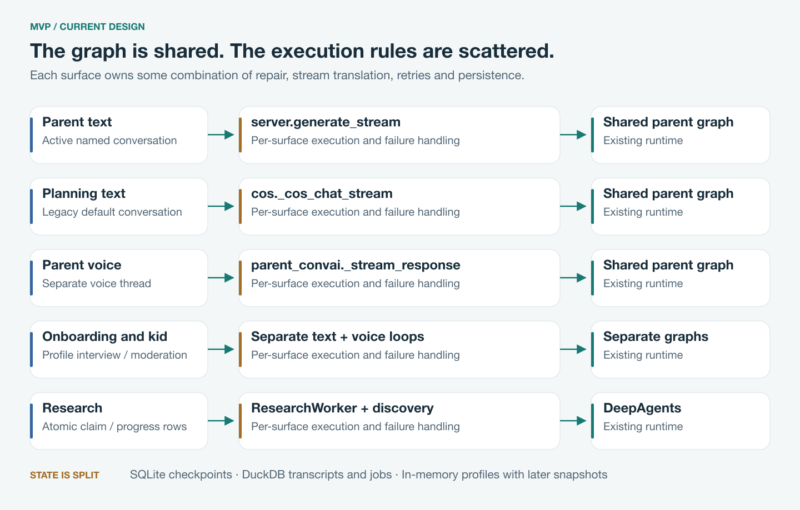
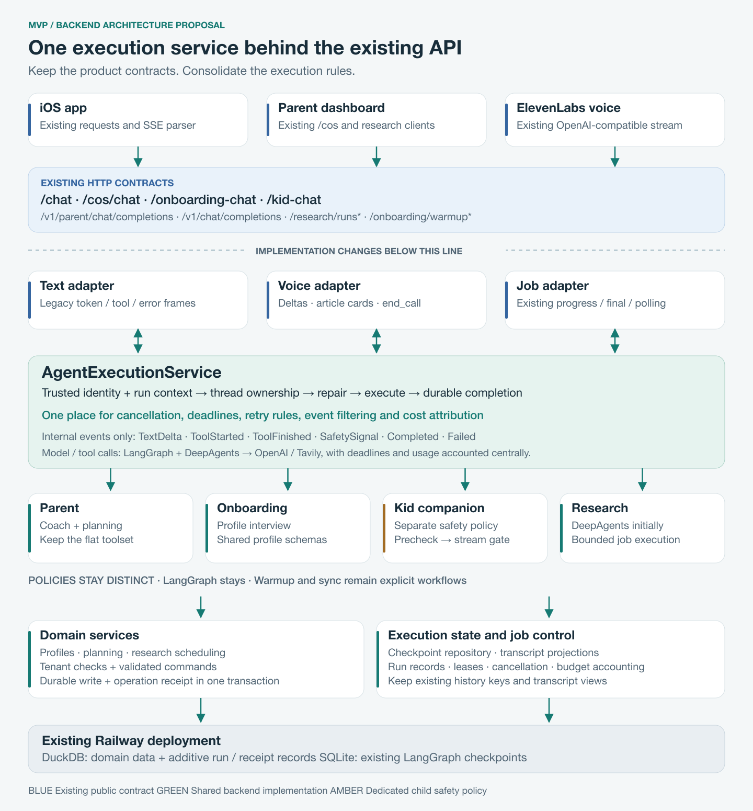
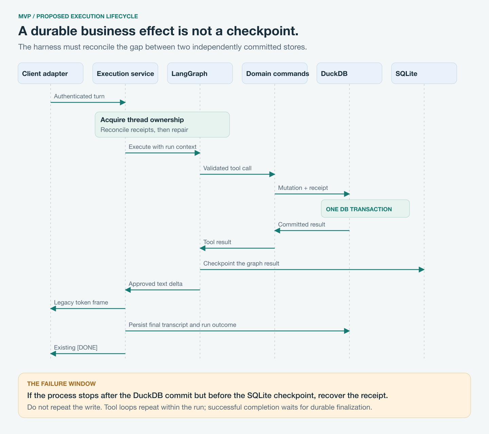
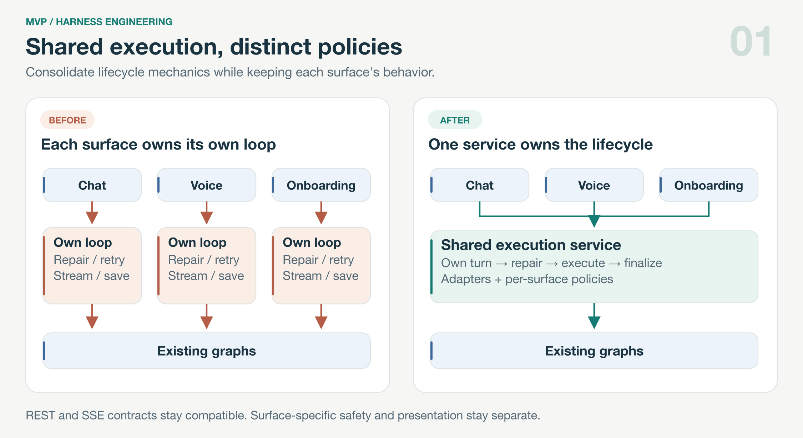
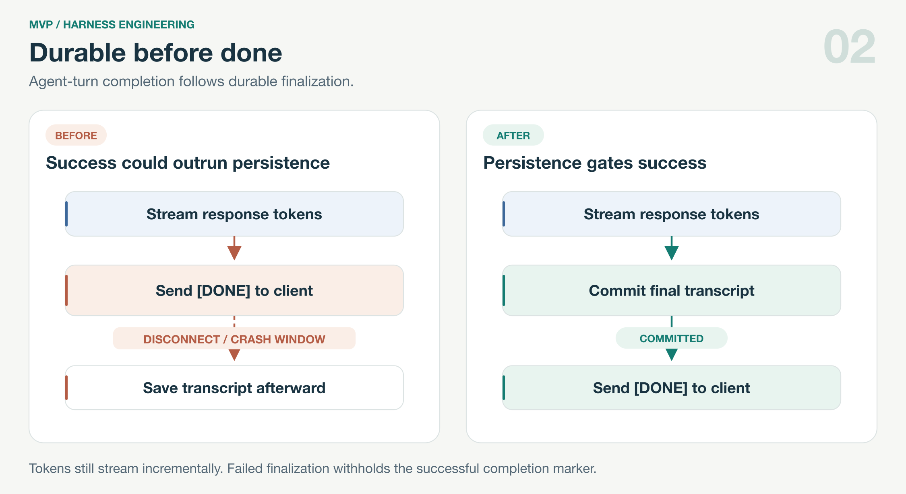
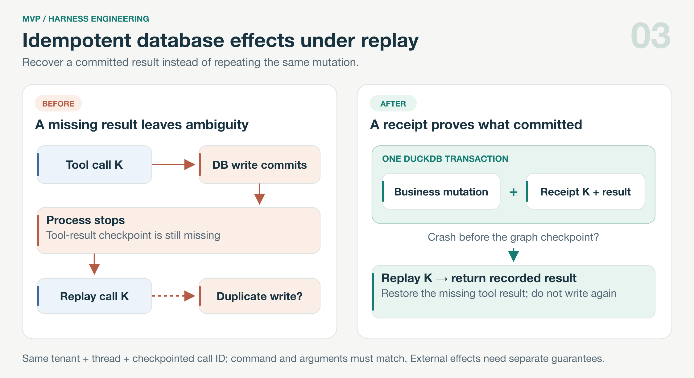
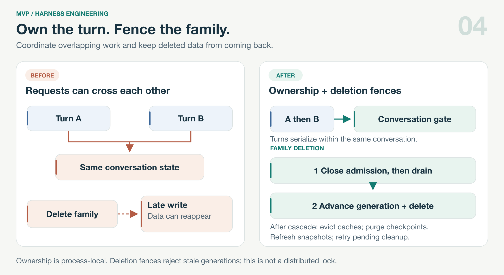
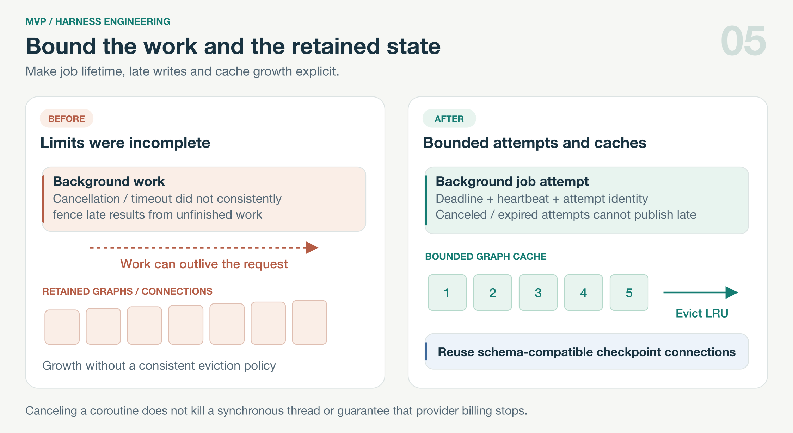

# MVP agent harness technical design

**Architecture review and refactor proposal · 10 October 2026 · Prepared for Miguel Alvarado**

## Recommendation

Keep LangGraph, the merged parent agent, and the existing REST API. Introduce a small shared execution service behind the current routes, with separate adapters for text, voice, and background jobs. Make durable writes, conversation ownership, cancellation, and recovery explicit responsibilities of that service.

The current design is a credible beta implementation, but it is not the best foundation for further development. The graph abstraction is already doing useful work. The weakness is the application harness around it: execution rules are repeated across entry points, while persistence and failure handling depend on which surface invoked the same agent.

**Target: no required iOS or dashboard changes.** Preserve URLs, request bodies, authentication, status codes, response types, SSE event envelopes, voice tool deltas, and existing conversation keys. Treat behavior corrections as separate, flagged changes after the structural extraction.

### The three priorities

1. **One execution path.** Centralize thread resolution, repair, event normalization, retry eligibility, cancellation, and telemetry. Preserve each surface's presentation and safety behavior.
2. **Durable outcomes.** Commit profile and planning mutations before reporting success. Record tool operation receipts so recovery can distinguish a completed write from a missing checkpoint result.
3. **Bounded work.** Enforce per-run deadlines, tool and model limits, and job cancellation. Add family budget accounting without making it a new client protocol.

### Scope and boundaries

This proposal covers parent coaching and planning, onboarding chat, kid text and voice, research, and the shared mechanics used by warmup and sync workers. It does not decide the product pivot, merge voice and text history, remove the kid companion, change prompts or models, replace DuckDB, or introduce a general multi-agent supervisor.

The intended end state remains one deployable FastAPI backend on Railway. Database and queue replacement can be considered later if measured concurrency or operating requirements justify it.

### Review basis

The 84 Python files under `mvp-backend/app` match the clean GitHub checkout at `798d2f44ea7bec6a17a09b3f8f4ad10f9a0efe0a`. Source references in this document use **artesanobuilds/parent-app**. GitHub CLI identity was verified as **artesanobuilds**; the original local checkout has no remote.

The focused offline baseline passed **72 tests** with five dependency warnings, temporary databases, and network access blocked. Findings below distinguish code-confirmed behavior from failure risks; this is not a production incident report or a live-model quality benchmark.

<!-- pagebreak -->

## Current architecture



### What is already worth keeping

The parent agent combines coaching, profile tools, and planning in one graph. A parent can ask for emotional support and a practical plan in the same turn. The COS shim reuses that graph, and the flat tool registry is a reasonable starting point at the current size. There is no evidence here that an extra model-based routing step would improve the experience. [E1]

The shared SQLite checkpointer preserves conversational state across restarts. Repair handles dangling tool calls. Internal summarizer output is tagged and filtered. Research has durable job rows, atomic claims, enqueue deduplication, and conditional terminal updates. Kid safety is enforced in application code around the graph, including a persistent crisis lock. These are valuable protections to preserve. [E4] [E5] [E6] [E8]

| Workload | Runtime today | Important distinction |
| --- | --- | --- |
| Parent text and voice | Shared `create_agent` graph | Three separate execution loops and different transcript handling |
| Onboarding | Separate `create_agent` | Profile interview tools; no parent middleware stack |
| Kid text and voice | Separate `create_agent` | Dedicated prechecks, stream moderation, locks and voice termination |
| Research | DeepAgents in worker threads | Long-running discovery with database progress |
| Warmup and sync | Explicit Python workflows | Shared job mechanics are useful; a conversational agent is unnecessary |

<!-- pagebreak -->

## Critique and evidence

### 1  Conversation routing has already drifted

**Code-confirmed.** `/chat` resolves the active named conversation and passes it into `thread_key`. `/cos/chat` calls the same helper without `conversation_id`, so it resolves to the legacy default. Once a named conversation is active, the two text surfaces no longer share the same checkpoint thread, despite the shared-agent intent. The existing helper test compares only the default case. [E2] [E3] [E9]

**Change:** extract a resolver with a compatibility policy first. Then fix named-conversation routing behind a separate flag. Preserve legacy history; do not silently copy or merge old threads.

### 2  Completion and durability are different events

**Code-confirmed ordering; loss is a failure risk.** Parent and onboarding text emit `[DONE]` before appending the assistant transcript and calling `persist_state`. COS similarly emits `[DONE]` before saving its assistant message. Parent profile tools update an in-memory service; the parent voice execution path has no corresponding per-turn profile flush. A crash or cancellation can therefore separate what the user heard, what the graph remembers, and what survives in domain storage. [E2] [E3] [E7] [E10]

**Change:** durable profile commands and transcript finalization precede successful completion. Keep token streaming incremental. Decouple global parquet export from per-turn commits only after verifying the existing restore path.

### 3  Repair fixes protocol shape, not business effects

**Code-confirmed limitation.** `repair_thread` removes unanswered tool calls. It cannot establish whether a tool already wrote data before its result was checkpointed. `add_todo` creates a new UUID for each call. Replaying a mutation after an ambiguous failure can duplicate an effect. The retry condition “no assistant text yet” does not prove “no tool write yet.” [E4] [E11]

**Change:** store a stable operation receipt alongside each mutation. Reconcile completed effects before repair discards their call metadata. Never restart a mutating turn solely because no text has streamed.

### 4  Shared storage does not serialize shared conversations

**Risk inferred from the execution paths.** No per-conversation execution gate surrounds repair plus graph invocation. SQLite and DuckDB locks protect storage operations, not the whole logical turn. Two requests can target the same thread while one is repairing or writing it. [E2] [E3] [E4]

**Change:** a shared gate spans resolution, repair, execution and finalization. A later voice turn cancels and joins the previous one before taking ownership. Family deletion also fences in-flight writes.

<!-- pagebreak -->

## Critique continued

### 5  Cancellation can stop the UI without stopping the work

**Code-confirmed.** Research cancellation updates the job row; the synchronous discovery call continues. Conditional finalization prevents a canceled run from becoming done, but it does not stop model spend. Research has a per-model-call timeout and recursion limit, but no total run deadline. Warmup's `future.result(timeout=...)` bounds waiting; it does not terminate the underlying thread. [E5] [E6]

**Change:** propagate cancellation and deadlines into model and tool boundaries, reject writes from expired job attempts, and use bounded provider timeouts. A hard kill requires process isolation; do not describe a thread timeout as one.

### 6  Dependency wiring and policy ownership are mixed together

**Code-confirmed.** Agents and tools reach back into `app.server` for storage. Parent and onboarding graph caches embed per-user prompt context; context changes rebuild the graph, and the dictionaries have no size bound. Parent and onboarding separately define profile update schemas, which have already diverged: onboarding includes `secondary_language`; the parent tool schema does not. [E1] [E7] [E12]

**Change:** initialize dependencies in the app lifespan, inject trusted run context, share profile schemas, and make capabilities explicit per agent. Retain the current factories during extraction; move to bounded caches or reusable graphs only after tenant-isolation tests pass.

### 7  Existing tests protect incidents better than complete runs

**Code-confirmed coverage shape.** The merged harness suite checks tool registration, async middleware, real-graph summarizer filtering, and source-level presence of repair calls. Those checks are useful but cannot prove correct route-specific ordering, named-conversation parity, concurrent turns, or durable tool outcomes. The dedicated eval runner constructs a synthetic kid agent; it is not a production parent-harness evaluation. [E9] [E13]

**Change:** add fault-injection and contract tests around the real execution service, then add a small scenario evaluation set for parent coaching and planning. Preserve the existing tests rather than replacing them with implementation snapshots.

### Alternatives considered

| Option | Assessment |
| --- | --- |
| Shared service around the current graphs | Recommended. Directly addresses observed coupling while preserving runtime behavior. |
| Replace LangGraph with a custom loop or another SDK | Recreates checkpoint, streaming and repair integration. No measured benefit yet justifies that migration. |
| Supervisor with many specialist agents | Adds routing and state boundaries before fixing the current ones. Keep specialized safety and research policies without adding a supervisor. |
| Move immediately to Postgres and an external queue | May help future scale, but does not fix stream semantics or idempotency. Separate infrastructure work from this refactor. |

<!-- pagebreak -->

## Proposed harness architecture



**Read top to bottom:** public contracts remain at the boundary. Adapters translate internal execution events. The service owns run lifecycle; agent policies own capabilities and safety; domain services own durable business effects. State repositories retain the existing storage engines initially.

The diagram shows the complete proposed target. Run receipts, leases and durable budget accounting arrive through additive migrations in later phases; they are not prerequisites for the first extraction.

<!-- pagebreak -->

## Execution service and internal interfaces

`AgentExecutionService` is an application service, not a replacement agent framework. It owns lifecycle mechanics and delegates model/tool looping to the existing runtime. Text and voice adapters implement separate presentation rules; research uses a job runner that shares lifecycle policies without pretending to be a chat turn.

### Proposed module boundaries

```text
app/agent_runtime/
  service.py          # run lifecycle, repair and retry decisions
  context.py          # trusted principal, thread, run and limits
  events.py           # typed internal events; no HTTP serialization
  sessions.py         # legacy keys, conversation gate, ownership
  policies.py         # parent / onboarding / kid / research policies
  adapters/           # text SSE, voice deltas, job progress
  repositories.py     # checkpoints, receipts, transcript projections
app/services/
  profiles.py         # shared schema and durable profile commands
  planning.py         # existing domain logic behind command methods
app/jobs/
  runner.py           # claim, deadline, cancellation and finalization
```

### Internal interface sketch

```python
# Design sketch; names are illustrative, not a new public API.
RunContext(
    principal, agent_kind, surface, run_id, thread_key,
    conversation_id, deadline, cancellation, limits, services
)

AgentExecutionService.stream(turn, context) -> AsyncIterator[RunEvent]
JobRunner.execute(job, context) -> JobResult

# Public adapters select only their established event vocabulary.
RunEvent = TextDelta | ToolStarted | ToolFinished | SafetySignal \
         | Progress | Completed | Failed
```

`principal` comes from the existing authenticated route or verified voice integration context. The model cannot choose a tenant, database connection, capability set, or deadline. Tools continue to check resource ownership within domain commands.

### Required ordering

1. Authorize using the existing route logic; capture the selected conversation once.
2. Acquire conversation ownership; initialize the run and applicable limits.
3. Reconcile known tool receipts, then repair interrupted checkpoint messages.
4. Build current family context and execute the selected graph and safety policy.
5. Normalize events; expose only approved user-facing model text and surface events.
6. Finalize durable transcript/domain outcomes, then emit the existing success terminator.
7. In `finally`, record the outcome, close the upstream iterator and release ownership.

Failures before response headers retain existing HTTP behavior. Failures after streaming starts use the surface's existing error path. Internal events and run identifiers do not become new required client fields.

<!-- pagebreak -->

## Turn lifecycle and failure recovery



This sequence expands the mutation path inside the proposed harness. Model/tool steps may repeat; each mutation keeps its own operation identity. Pure answers skip the domain-command transaction. Kid output passes its safety gate before becoming an adapter-visible text delta.

The important boundary is between the DuckDB transaction and the SQLite checkpoint. Recovery must reason about that gap explicitly. Returning a structurally valid conversation to the model does not prove the prior business action failed.

<!-- pagebreak -->

## Persistence and recovery design

### Three stores with explicit responsibilities

**Checkpoint state** belongs to the graph and remains in SQLite. **Domain truth** belongs to profiles, activities, calendars and tasks in DuckDB. **Transcript projections** serve the existing history endpoints. They may share a run identity internally, but none substitutes for the others.

Keep current checkpoint keys and existing history projections during the refactor. Centralize their writes without immediately moving their schemas. A checkpoint schema or node-name change needs an old-checkpoint compatibility test; extraction alone should not introduce one.

### Durable command boundary

Add a DuckDB operation-receipt table keyed by tenant, durable run ID and logical operation ID. Store command kind, argument digest, outcome and resulting entity IDs. Within the same transaction and connection lock, validate ownership, check for an existing receipt, apply the mutation, and commit its receipt. Reusing an operation ID with different arguments is an error.

The logical operation ID is assigned before dispatch and retained across recovery. Use the persisted tool-call identity where stable; preserve the mapping when reconciling graph state. A fresh model invocation that invents a new tool-call ID is not automatically a replay. Avoid blanket turn retries after an ambiguous mutation.

For local writes, this supports one committed effect for a known operation. For external writes, use a transactional outbox plus provider idempotency or read-back reconciliation. Do not claim exactly-once behavior for providers without those guarantees.

**Client limitation:** existing chat requests lack a durable client message ID. This design prevents internal replay of a known operation; it cannot reliably distinguish two identical intentional messages from an HTTP resend after a lost response. Do not deduplicate by message text. A future optional idempotency header could improve newer clients without being required for this refactor.

### Profiles and transcript completion

Replace agent-only in-memory profile mutations with a service that commits the existing profile JSON representation before returning success, then refreshes or invalidates the cache. Use the same service for text and voice. Consolidate parent/onboarding schemas without changing `/profile` JSON types.

Append the user turn durably before model execution. Store finalized assistant text before success completion; retain a failed or interrupted internal run outcome if no final answer exists. Keep current public history shapes. Do not synthesize a successful assistant reply for an interrupted turn.

SQLite checkpoints and DuckDB cannot participate in one local transaction. Use run/operation IDs and reconciliation to handle a crash between them. Prefer a committed domain effect with recoverable metadata over replaying an uncertain command.

### Deletion and retention

Extend family deletion to run records, receipts, pending jobs, transcript projections and graph caches. Fence the family before deleting so an older in-flight worker cannot recreate data. Track checkpoint purge failure for retry instead of silently considering deletion complete internally. Retention remains a separate product decision; keep content out of telemetry and avoid copying raw prompts into the run ledger.

<!-- pagebreak -->

## Concurrency cancellation and execution limits

### Conversation ownership

Use one service-owned gate per canonical checkpoint thread in the current single-process deployment. Hold it across repair, invocation and finalization. Text turns queue in order with a bounded wait. A new voice turn may supersede its previous turn, but it must cancel and join that execution before acquiring the same thread. Cancellation never transfers ownership while an old mutation can still commit. Coroutine cancellation alone is insufficient if a tool continues in a thread; retain ownership until it finishes or its writes are fenced.

A process-local lock is not a multi-instance solution. Before adding backend replicas, move ownership to durable leases with fencing tokens and revisit DuckDB's single-writer deployment. Do not add replicas while assuming this refactor makes the existing storage architecture horizontally scalable.

### Background jobs

Keep the existing research, warmup, email and calendar tables and their wire states. Introduce a common claim/heartbeat/deadline/cancellation interface around them. Startup recovery remains; a periodic reaper also handles expired attempts while the process is alive.

Each claim receives an attempt token. Progress, candidate publication and finalization verify that token and the current run status. Stage research results, then publish candidates and terminal success atomically so a canceled or expired attempt cannot publish late results. Warmup step writes use the same fence, including steps that finish after their caller timed out.

Move blocking research calls toward cancellable async calls where supported. Check cancellation before every model/tool dispatch and durable write. Provider timeouts bound outstanding calls; retries consume the remaining run deadline. For a strictly enforceable wall-clock kill of uncooperative code, use a subprocess for that workload rather than accumulating timed-out threads.

### Limits and telemetry

| Control | Proposed enforcement |
| --- | --- |
| Model and tool calls | Count at dispatch; preserve current parent limit initially; explicit budgets per policy |
| Run duration | Monotonic deadline; per-call timeout cannot exceed remaining time |
| Family concurrency | Bounded admission for expensive research; retain existing enqueue deduplication |
| Family spend | Durable reservations before work; reconcile actual usage; include internal model calls and search |
| Retry allowance | One centrally owned policy; no independent nested retry budget multiplication |

Start spend limits in observe-only mode, using measured beta workloads to choose thresholds. Token prices and search estimates are imperfect; expose accounting uncertainty operationally instead of promising an exact dollar ceiling. Hard call/token limits provide the deterministic boundary.

Record run ID, surface, policy/model version, outcome, model/tool latency, time to first public token, repair count, retries, cancellation delay and persistence latency. Metrics carry no transcript or family-profile content. Preserve existing voice timing distinctions and cost correlation IDs.

<!-- pagebreak -->

## REST and mobile compatibility contract

The first extraction must preserve route behavior, including differences between routes. Do not normalize the public API while normalizing the internal event model. OpenAPI snapshots alone are insufficient because they do not describe the streamed protocol.

| Surface | Preserve exactly | Specific regression guard |
| --- | --- | --- |
| `/chat`, `/onboarding-chat` | Request fields/defaults, auth, token `type/content`, tool `type/tool`, error envelope, successful `[DONE]` | Drive actual route generators with deterministic fake graph events |
| `/cos/chat`, `/cos/messages` | Same SSE envelope; separate legacy COS transcript projection | Named/default thread scenarios plus existing message history JSON |
| `/kid-chat` | `frozen`, `crisis`, `blocked`, `retract`, safe replacement text and terminal behavior | Input block, midstream block, final-flush block and locked-agent paths |
| Parent voice endpoint | OpenAI chunk envelope, `show_article` arguments, link stripping, silence nudges, shared-secret auth | Split links across chunks; no raw content URLs spoken |
| Kid voice endpoint | Existing deltas, moderation, crisis lock and `end_call` behavior | No unsafe text bypass; lock persists before client termination |
| `/research/runs*` | Create/poll/cancel/candidate JSON; `progress`, `final`, `timeout`, `[DONE]`; `canceled` spelling | Cancel races, reconnect/poll fallback, stale attempt completion |
| `/onboarding/warmup*`, `/coach/nudge` | Step fields, progress shape, completion with degraded steps, nudge schema | Timed-out step cannot publish after expiration |
| Profile and planning REST | Existing models, scalar types, CRUD side effects and ownership checks | Both onboarding paths; string kid ages; numeric fit fields; cascade deletion |

The Swift parser stops at `[DONE]`; moving durable completion before that existing marker needs no new parser. Voice still requires its own adapter because its OpenAI-style deltas and client tools are different from text SSE. The dashboard consumes `/cos/chat`; its current parser ignores non-token events, so preserve the error envelope and avoid claiming that all clients visibly render errors today. [E14]

### Intentional behavior changes after extraction

Route `/cos/chat` to the active named conversation only in a separate change, retaining the default when none is active. Save before successful completion. Prevent duplicate internal mutations. Enforce deadlines and cancellation through existing failure representations. These changes are client-compatible goals, not proof of zero behavioral impact; validate them independently.

Keep voice history separate. Preserve current kid-name identifiers at the boundary; stable kid IDs require a separate compatibility migration. Do not add approval interrupts that require a new mobile UI as part of this work.

<!-- pagebreak -->

## Refactor plan and reviewable changes

Use a fresh branch in the clean `artesanobuilds/parent-app` checkout. Port only reviewed documentation and implementation files from this original workspace. Each step below should be independently reviewable; larger steps may split into smaller PRs.

### PR 0  Freeze observed contracts

**Scope:** tests only. Capture deterministic route/SSE fixtures, OpenAPI, voice probes/tool deltas, and history responses. Add named-conversation and interrupted-write reproductions. Mark intended corrections explicitly instead of making current defects the target specification.

**Exit:** baseline fixtures pass on the current implementation; every touched route has a success and failure case. No production data or real vendor requests in the contract suite.

### PR 1  Extract adapters and dependency wiring

**Scope:** `agent_runtime/events.py`, text/voice adapters, lifespan-owned dependencies, thin compatibility wrappers in existing route modules. Keep prompts, tools, graph factories, thread keys, middleware and persistence ordering unchanged.

**Exit:** deterministic fake-model streams produce the same ordered public events; voice link stripping and safety signals match. No schema migration. Each surface can switch back to its legacy implementation.

### PR 2  Centralize execution and conversation ownership

**Scope:** shared parent turn runner, thread resolver, internal event filtering, repair, telemetry and single-process conversation gates. Adopt parent text first, COS next, parent voice last. Preserve route-specific thread resolution during extraction.

**Exit:** simultaneous text requests cannot repair or mutate the same checkpoint concurrently; voice cancellation releases ownership only after execution stops. Legacy checkpoint fixtures remain readable. Keep rollback selection fixed for the lifetime of a run.

### PR 3  Fix durable effects and completion

**Scope:** shared profile command/schema service, additive run/operation receipt storage, transactional planning commands, transcript finalization before completion. Preserve current transcript projections and REST representations. Add deletion fencing and purge coverage for new state.

**Exit:** crash after a committed tool write and before its checkpoint result does not duplicate that known operation on recovery. Voice profile updates survive restart. A storage failure cannot yield successful completion. No raw prompts in the ledger.

**Migration:** additive only, with backup and restore rehearsal on disposable data. Production application of the migration requires a separately authorized deploy under the existing runbook.

**Recommended first milestone:** stop after PR 3 and assess reliability and latency. This already removes the most consequential harness fragmentation without a framework or infrastructure migration.

<!-- pagebreak -->

## Remaining phases and rollout

### PR 4  Correct named conversation routing

Route COS through the shared active-conversation resolver under a dedicated behavior flag. Resolve once at admission so a later “switch conversation” action cannot redirect an in-flight turn. Preserve legacy default checkpoints and `/cos/messages` history semantics.

**Exit:** iOS and dashboard continue the intended named conversation; reopening old histories still works. No historical conversation merge or mobile release is required.

### PR 5  Bound background work

Introduce job attempt fencing, total deadlines, cancellation propagation, periodic stale-run recovery and atomic candidate publication. Apply the common job runner to research first, then warmup. Keep email/calendar scheduling and deterministic workflow logic intact; migrate their common mechanics only where tests prove a benefit.

**Exit:** cancellation prevents further dispatch and late writes; expired attempts cannot finalize a newer run; retries stop at the run budget. Distinguish cooperative cancellation from hard process termination in metrics and tests.

### PR 6  Adopt specialized policies and simplify caches

Move onboarding onto the shared service using the shared profile schema. Move kid surfaces last, retaining their safety policy and buffering order. Inject run context into tools and middleware; then evaluate reusable graphs or bounded caches. Add parent scenario evaluations before altering prompts, models or tool selection.

**Exit:** all moderation regressions pass, tenant isolation holds under concurrent runs, and internal model output never reaches a public stream. Warmup and sync remain workflows. Pin framework versions during the refactor; upgrade separately.

### Rollout and rollback

Use a server-side switch per surface and a separate flag for each intentional behavior correction. First validate offline, then staging with synthetic families, then an explicitly authorized beta cohort. Observe sufficient representative turns per surface before expanding; elapsed time alone is not evidence.

Shadow only pure normalization and recorded/fake execution. Never run old and new mutating agents against the same live family to compare their answers. A shared durable receipt does not make two independent model plans equivalent.

Rollback changes admission for new turns; drain or cancel existing runs through their original implementation. Keep additive columns/tables and old history readers compatible. Once durable command handling is enabled, all rollback paths must retain those command guarantees: switch back presentation/orchestration behind the shared command service, or pause writes. Do not roll all the way back to a binary that bypasses active receipt or fencing rules.

### Effort and decisions

Planning estimate for one experienced engineer: PRs 0–3 approximately **8–13 engineering days**; remaining phases approximately **7–12 days**, plus beta observation. These are estimates, not measured commitments. Killable worker isolation or storage replacement would be separate scope.

Review decisions: accept the shared-service boundary; approve the named-conversation correction as a separate behavior change; choose rollout thresholds from baseline measurements. Product decisions about kid companion scope, voice/text history and transcript retention remain outside this refactor.

<!-- pagebreak -->

## Validation and acceptance gates

### Tests that decide whether this design is working

| Test | Required outcome |
| --- | --- |
| Public contract replay | Identical event shapes and semantic ordering for deterministic graph fixtures; no new required request fields |
| Named and legacy threads | Default keys preserved; new conversation routing follows the separately selected policy |
| Interrupted tool write | One domain effect for the same operation ID; recovery returns the receipt, never blindly replays |
| Failure before final persistence | Existing error path, with no successful terminator before durable finalization |
| Concurrent turns and deletion | No shared-thread interleaving; deleted family cannot be recreated by an older run |
| Internal model calls | Summaries and other internal tokens absent from text and voice output |
| Child safety | Precheck, streaming block, final-flush block, lock and reactivation behaviors retain their existing gates |
| Research and warmup cancellation | No new dispatch after acknowledgment; late attempts cannot publish or commit |
| Tenant isolation | Context, tools, caches, receipts and checkpoints cannot cross family boundaries |

### Performance and quality gates

Measure baseline and candidate on the same fixed scenarios. Proposed initial gate: deterministic harness overhead adds no more than 50 ms to p95 time to first public token; validate this threshold against measurement noise. Separately track completion latency added by durable writes. Do not compare unrelated live-model requests and attribute their variance to the harness.

Evaluate mixed coaching/planning, profile correction, planning mutations, research grounding, provider failures and voice interruptions. Require all deterministic safety/ownership/contract cases to pass. Require no regression on the agreed scenario set before changing prompts or models. Select cost and latency targets from baseline data before rollout.

### Baseline executed for this review

```text
tests/agents/
tests/test_thread_repair.py
tests/test_research_worker.py
tests/test_durable_checkpointer.py

72 passed, 5 warnings in 2.12s
```

The suite ran in temporary storage with dummy vendor credentials and outbound socket connections blocked. Warnings concerned Tavily field names, a multipart import deprecation and LangChain event API v1 deprecation. Passing this suite does not validate the new design, demonstrate absence of the identified failure risks, or establish live response quality.

For implementation commits, run the repository's required backend, web and iOS checks. Exercise existing mobile parsers with the new backend and test old persisted checkpoints. No implementation, production migration or deploy is part of this proposal.

<!-- pagebreak -->

## Technical walkthrough

### Start with the system and constraint

“MVP has an existing mobile app, text and voice agents, and asynchronous research. The parent agent already combines coaching and planning. I reviewed the surrounding harness to improve reliability while preserving the REST and streaming contracts, so the refactor would not require a coordinated mobile release.”

### Explain what already exists

The code already includes persistent graph checkpoints, dangling-tool-call repair, filtering for internal summarizer tokens, and domain-specific safety gates. These are implemented protections visible in the source. The review validated a focused 72-test offline baseline; it did not implement the proposed shared execution service.

### Walk through one consequential failure

Use the lifecycle diagram: a task write commits, then the process stops before the graph checkpoints the tool result. The next request sees an unanswered tool call. Repair makes the model history valid, but cannot establish whether the task was saved. Blind retry can create another task. A transactional operation receipt lets the harness recover the result of that known operation.

This example connects agent orchestration to conventional distributed-systems concerns: idempotency, transaction boundaries, concurrency and reconciliation. It also explains why swapping models or frameworks would not solve the underlying problem.

### Defend the main tradeoffs

**Why keep LangGraph?** It already handles the model/tool loop and checkpoint integration. The concrete duplication lives outside it, in application execution paths.

**Why not one agent for everything?** Shared runtime mechanics do not imply shared capabilities. Kid moderation, voice transport and long-running research need different policies.

**Why keep the flat parent toolset?** Mixed coaching/planning turns need access to both domains. There is no benchmark here supporting an extra routing model; evaluate that only if tool-selection quality or latency becomes a measured issue.

**How do you avoid breaking mobile?** Preserve the public adapters and characterize their real streams. Make internal event types private. Roll out each surface independently, then apply behavior fixes separately.

**What does the refactor not guarantee?** It does not provide exactly-once HTTP delivery without client message identity, make threads killable, or make DuckDB a multi-instance database. Those limits are explicit in the design.

### Close with the next measurable milestone

The first milestone is contract coverage, shared parent execution, and durable command handling. Demonstrate that a known interrupted mutation does not duplicate, profile updates survive restart, and concurrent requests cannot corrupt one thread. Performance improvements remain hypotheses until measured; do not present proposed outcomes as achieved results.

<!-- pagebreak -->

## Source map and technical references

All code links below are pinned to the verified clean **artesanobuilds/parent-app** revision. File positions identify the relevant entry points; findings should be rechecked if those implementations change.

| Ref | Evidence |
| --- | --- |
| [E1] | `app/agent.py`: thread keys, parent middleware, tool registry and per-user graph cache |
| [E2] | `app/server.py`: `persist_state`, parent and onboarding streaming, completion ordering |
| [E3] | `app/cos/router.py`: COS thread resolution, stream loop and transcript persistence |
| [E4] | `app/thread_repair.py`: message repair; `app/checkpointing.py` remains the shared SQLite saver |
| [E5] | `app/research/worker.py`: claim/process/finalize; cancellation does not interrupt discovery |
| [E6] | `app/onboarding_warmup.py`: thread-pool step timeout and finalization |
| [E7] | `app/profiling.py`: profile updates mutate the in-memory store |
| [E8] | `app/server.py`: kid moderation and persistent crisis-lock ordering |
| [E9] | `tests/agents/test_merged_agent_harness.py`: current harness regression coverage |
| [E10] | `app/parent_convai_endpoint.py`: voice repair, streaming, retry and cleanup |
| [E11] | `app/duckdb_storage.py`: `add_todo` creates a fresh UUID and inserts |
| [E12] | `app/onboarding_agent.py`: duplicated profile schemas and graph construction |
| [E13] | `app/evals/runner.py`: synthetic kid-agent evaluation scope |
| [E14] | `mvp/MVP/ChatService.swift`: existing mobile SSE parser |

Additional implementation references: [research API and cancellation][R1], [research graph and call limits][R2], [checkpoint proxy and deletion][R3], [planning tools and storage coupling][R4], and [dashboard SSE parser][R5].

### Framework grounding

LangChain documents runtime context as the mechanism for injecting per-invocation identity and dependencies into tools and middleware. That supports the proposed context boundary without requiring a new framework. Verify the installed pinned versions before choosing exact async hooks. [Runtime documentation](https://docs.langchain.com/oss/python/langchain/runtime)

LangGraph distinguishes checkpointed thread state from application-defined long-term stores. This supports keeping graph state separate from domain truth; a checkpoint alone is not a transaction covering business effects in DuckDB. [Persistence documentation](https://docs.langchain.com/oss/python/langgraph/persistence)

### Artifacts

The review is maintained in this Markdown source. The PDF is generated from the same text. Editable diagrams are in `assets/*.svg`; PNGs provide Markdown previews. `render_diagrams.py` and `render_document.py` reproduce the figures and document. The PDF builder needs ReportLab, PyMuPDF and `rsvg-convert`; run it in an isolated document environment. Proposed interfaces are design sketches, not committed application code.

[E1]: https://github.com/artesanobuilds/parent-app/blob/798d2f44ea7bec6a17a09b3f8f4ad10f9a0efe0a/mvp-backend/app/agent.py#L99
[E2]: https://github.com/artesanobuilds/parent-app/blob/798d2f44ea7bec6a17a09b3f8f4ad10f9a0efe0a/mvp-backend/app/server.py#L423
[E3]: https://github.com/artesanobuilds/parent-app/blob/798d2f44ea7bec6a17a09b3f8f4ad10f9a0efe0a/mvp-backend/app/cos/router.py#L61
[E4]: https://github.com/artesanobuilds/parent-app/blob/798d2f44ea7bec6a17a09b3f8f4ad10f9a0efe0a/mvp-backend/app/thread_repair.py#L44
[E5]: https://github.com/artesanobuilds/parent-app/blob/798d2f44ea7bec6a17a09b3f8f4ad10f9a0efe0a/mvp-backend/app/research/worker.py#L102
[E6]: https://github.com/artesanobuilds/parent-app/blob/798d2f44ea7bec6a17a09b3f8f4ad10f9a0efe0a/mvp-backend/app/onboarding_warmup.py#L531
[E7]: https://github.com/artesanobuilds/parent-app/blob/798d2f44ea7bec6a17a09b3f8f4ad10f9a0efe0a/mvp-backend/app/profiling.py#L168
[E8]: https://github.com/artesanobuilds/parent-app/blob/798d2f44ea7bec6a17a09b3f8f4ad10f9a0efe0a/mvp-backend/app/server.py#L1827
[E9]: https://github.com/artesanobuilds/parent-app/blob/798d2f44ea7bec6a17a09b3f8f4ad10f9a0efe0a/mvp-backend/tests/agents/test_merged_agent_harness.py#L175
[E10]: https://github.com/artesanobuilds/parent-app/blob/798d2f44ea7bec6a17a09b3f8f4ad10f9a0efe0a/mvp-backend/app/parent_convai_endpoint.py#L220
[E11]: https://github.com/artesanobuilds/parent-app/blob/798d2f44ea7bec6a17a09b3f8f4ad10f9a0efe0a/mvp-backend/app/duckdb_storage.py#L5371
[E12]: https://github.com/artesanobuilds/parent-app/blob/798d2f44ea7bec6a17a09b3f8f4ad10f9a0efe0a/mvp-backend/app/onboarding_agent.py#L104
[E13]: https://github.com/artesanobuilds/parent-app/blob/798d2f44ea7bec6a17a09b3f8f4ad10f9a0efe0a/mvp-backend/app/evals/runner.py#L119
[E14]: https://github.com/artesanobuilds/parent-app/blob/798d2f44ea7bec6a17a09b3f8f4ad10f9a0efe0a/mvp/MVP/ChatService.swift#L56
[R1]: https://github.com/artesanobuilds/parent-app/blob/798d2f44ea7bec6a17a09b3f8f4ad10f9a0efe0a/mvp-backend/app/research/router.py#L214
[R2]: https://github.com/artesanobuilds/parent-app/blob/798d2f44ea7bec6a17a09b3f8f4ad10f9a0efe0a/mvp-backend/app/research/graph.py#L464
[R3]: https://github.com/artesanobuilds/parent-app/blob/798d2f44ea7bec6a17a09b3f8f4ad10f9a0efe0a/mvp-backend/app/checkpointing.py#L103
[R4]: https://github.com/artesanobuilds/parent-app/blob/798d2f44ea7bec6a17a09b3f8f4ad10f9a0efe0a/mvp-backend/app/cos/tools.py#L27
[R5]: https://github.com/artesanobuilds/parent-app/blob/798d2f44ea7bec6a17a09b3f8f4ad10f9a0efe0a/mvp-backend/parent-dashboard/src/api/index.ts#L321


## What the refactor changed

**Implementation recap · 11 October 2026.** These five points summarize the work delivered after the original proposal above. The seven implementation PRs are merged and deployed; the new shared-runtime switches remain off for staged activation. See the [implementation notes](IMPLEMENTATION.md) and [production verification record](../../history/harness-production-rollout-2026-10-11.md) for evidence and coverage limits.

- **Duplicated execution logic → shared execution with distinct policies.** Chat, voice and onboarding handled streaming, retries and cleanup separately. The refactor introduces a shared execution service with surface-specific policies, preserving existing REST and streaming contracts so mobile clients need no coordinated update.

  

- **Success before durable storage → persistence before completion.** Some agent paths signaled completion before saving the answer. Successful agent turns now persist their final transcript before the completion marker, reducing lost conversations after disconnects. Tokens still stream incrementally; failed finalization does not report success.

  

- **Ambiguous recovery → database effects that are idempotent under replay.** An interruption could leave a committed mutation without a checkpointed tool result. Protected mutations and their operation receipts now commit in one DuckDB transaction. Replaying the same tenant, thread and tool-call ID with matching command arguments returns the recorded result instead of applying the mutation again. A new tool-call ID is a new operation; external effects need their own guarantees.

  

- **Competing turns and deletion races → conversation ownership and family fences.** Concurrent requests could conflict, and unfinished work could recreate deleted family data. Conversation gates now serialize turns; family deletion closes admission, drains admitted work, advances the generation and coordinates the cascade and subsequent cleanup. Stale writes are rejected, and failed cleanup remains recoverable. Ownership remains process-local.

  

- **Incomplete resource limits → bounded jobs and caches.** Background work and retained agent graphs lacked consistent lifetime and size limits. Jobs now use deadlines, heartbeats and attempt identities to reject late writes; graph caches use bounded LRU eviction, and compatible checkpoint connections are reused. Canceling a coroutine does not kill a synchronous thread or guarantee that provider billing stops immediately.

  

The figures are embedded PNGs for reliable README rendering, with matching editable SVGs in `assets/`. Reproduce this five-figure set with `python3 render_refactor_lessons.py` from this directory (`rsvg-convert` required). This implementation recap supplements the original design PDF.


### Coach voice follow-up: cancellation boundaries (October 11, 2026)

A production interruption exposed a latency tradeoff in whole-graph draining:
replacement turns could wait behind model generation for a reply no longer being
played. Coach voice now cancels and joins primary model I/O on disconnect, while
retaining conversation ownership until already-dispatched tools and graph cleanup
finish. A tool that reaches dispatch after disconnect returns a matching interrupted
ToolMessage; throwing from that tool boundary could cancel an active sibling.
The next model call is skipped. Expected interruptions are recorded as interrupted,
not application errors, and lifecycle logs include `ownership_wait_ms`.

This policy applies only to `parent_voice` and works with both legacy and shared
execution flags. Text and kid policies keep their existing behavior. Internal
summarization still drains if already running; it is outside the primary model
wrapper and triggers only at the configured long-conversation threshold.

The parent ElevenLabs agent uses a one-second soft timeout, eight random preset
fillers, and disabled speculative turns. The filler threshold is measured by the
provider and is not a one-second end-of-speech-to-audio guarantee. Random selection
can repeat. The provider normalizes its soft-timeout cap to the pool size, so the
pool does not enforce one filler per answer. `tools/parent_voice_config.py` inside
`mvp-backend` inspects by default; explicit apply/restore modes require a private
backup and verified readback. No mobile or REST/SSE contract changes are needed.
