# CI/CD and staging plan for MVP

**Status:** proposal, 2026-10-11. No workflow, environment, credential, or branch-protection changes have been applied. Informed by the [seven-release production rollout](../history/harness-production-rollout-2026-10-11.md).

## Recommendation

Use GitHub Actions for validation and release orchestration, one isolated Railway staging environment, and an explicitly approved production promotion. Keep the existing FastAPI/DuckDB/SQLite service and its bundled dashboard/CMS. Keep iOS delivery separate through TestFlight. No mobile API change is required.

Build the backend image once per release candidate. Test that image in staging, then promote the same image to production. Start with one staging environment rather than a preview environment for every PR: persistent state and background workers make isolated previews more work than this project currently needs.

```mermaid
flowchart LR
    PR[Pull request] --> CI[Offline backend matrix<br/>Web + iOS checks<br/>Contract + migration checks]
    CI --> M[Protected master]
    M --> I[Build image once<br/>Git SHA + image digest]
    I --> S[Railway staging<br/>Synthetic data + separate volume]
    S --> V[Live smoke + restart check<br/>Migration + flag validation]
    V --> A[Approve exact release]
    A --> B[Production backup gate]
    B --> P[Promote same image<br/>One deployment at a time]
    P --> R[Verify deployment ID + live checks<br/>Publish release receipt]
    R -->|failure| H[Stop promotion<br/>Forward fix or compatible rollback]
```

## What the rollout exposed

| Observation | Required change |
|---|---|
| GitHub Actions is disabled; no workflows are tracked; `master` has no branch protection | Enable reviewed workflows, then require their checks before merging |
| Expired interactive Railway login delayed deployment | Environment-scoped deployment tokens stored in GitHub environments |
| A TLS upload failed before build; a retry succeeded | Classify failures and inspect deployment state before retrying |
| Every release needed manual SHA, health, schema, content and cleanup checks | One repeatable smoke command and a machine-readable release receipt |
| Content parquet backup did not cover fresh family state or SQLite | Native volume snapshot gate before migration or cleanup changes |
| Backup creation/listing worked, but workflow-status authorization failed | Verify automation-token capabilities before relying on the backup gate |
| One PostHog deletion request timed out; a repeat succeeded | Separate application failures from vendor warnings; alert on persistent cleanup failures |
| New shared-runtime switches remain off in production | Exercise each enabled surface in staging before a separate production flag rollout |

## Environment boundaries

| Environment | State and integrations | Release rule |
|---|---|---|
| PR CI | Temporary DuckDB/SQLite, synthetic fixtures, no production secrets; model/network calls blocked | Untrusted PRs run tests only |
| Staging | Separate Railway service/volume/domain, auth and encryption secrets, bucket, synthetic identities; low-budget model project; isolated analytics and notification sinks | Automatically deploy validated `master` candidates; serialize deployments |
| Production | Existing real-family volume and domain, one application process/replica | Approve an exact staging-verified SHA/image and pass backup checks |

Do not copy production families, OAuth tokens, checkpoints or volume snapshots into staging. Bootstrap staging with synthetic profiles and a populated previous-schema fixture. Do not share production APNs, email recipients or ElevenLabs agents. Create dedicated staging integrations only where a real integration test is needed.

Railway supports environment-scoped project tokens for deployment automation. Use separate staging/production tokens; do not put a personal CLI login into CI. Establish and test the narrowest available credential for backup operations separately if the deployment token lacks that capability. [Railway CLI authentication](https://docs.railway.com/cli/deploying)

## Required checks

1. **Backend, Python 3.13 matching Docker:** install pinned dependencies and test tooling; run `python tools/test-harness-offline.py` and `python tools/test-harness-offline.py --shared` from `mvp-backend`. Preserve JUnit/results as sanitized artifacts. Current final baseline is 792 passed / 45 skipped in each mode. Treat skipped integration coverage as an explicit list, not proof it passed.
2. **Contracts and migrations:** retain the 23-route OpenAPI fixture and SSE tests. Rehearse migrations on populated synthetic prior-version state, restart twice, check valid-family isolation, checkpoint recovery and deletion fences. Include model-independent failure injection; do not deliberately crash production for these tests.
3. **Web:** for both dashboard and CMS, `npm ci --legacy-peer-deps`, TypeScript/build checks and the design-token linter. Audit committed lockfiles and align Docker with `npm ci`; fail cleanly on mismatch rather than updating lockfiles in CI.
4. **iOS:** compile on a pinned macOS/Xcode runner when iOS, shared contracts or networking change; run on an installed simulator selected explicitly. A generic SDK compile is useful but does not replace runtime/fresh-install coverage. Keep signing secrets out of PR jobs.
5. **Image:** build Linux/amd64 from `mvp-backend/`, inspect the final image for forbidden runtime files/secrets, and boot it against disposable storage. Pin base images, Python dependency resolution and the Railway CLI version. Bundle both web apps as today.

Use an always-reported aggregate required check so path-filtered jobs cannot leave a PR waiting forever. Run the full backend matrix on backend/contract changes; docs-only changes need link/format checks, not a production redeploy. Test the merge result as well as the PR head.

## Build and promote

Publish a uniquely tagged image such as `ghcr.io/artesanobuilds/parent-app-backend:sha-<commit>` and record its digest. Do not overwrite release tags or promote `latest`. Configure Railway to use that unique image reference and verify that staging and production resolve to the recorded digest; validate digest-addressed references during implementation before depending on their syntax. Railway documents unique tags and service-source updates for controlled releases. [Image deployment guide](https://docs.railway.com/guides/private-container-registry)

The current Dockerfile bakes dashboard analytics settings into the frontend. Before one-image promotion, choose either a small runtime configuration mechanism or a common baked configuration with staging analytics disabled/isolated. Do not rebuild a different frontend for production while calling it the same tested artifact.

Use a GitHub `production` environment with an explicit approval and branch restriction. Keep credentials unavailable until its protection rules pass. Set deployment concurrency to one per environment with `cancel-in-progress: false`; never cancel a migration because a newer push arrived. Revalidate the selected SHA/image and migration baseline after waiting for approval. Avoid a second Railway GitHub-autodeploy path bypassing these gates. [GitHub deployment controls](https://docs.github.com/en/actions/how-tos/deploy/configure-and-manage-deployments/control-deployments)

Public-repository workflows must not run untrusted PR code with production secrets or privileged `pull_request_target` jobs. Pin third-party Actions to reviewed commit SHAs. Protect `.github/workflows`, deploy scripts and migration policy changes with review.

## Deployment gates and rollback

Before any migration, startup cleanup or checkpoint-format change: capture a fresh native volume snapshot, record its ID/time/source release and verify platform availability. The content-only backup script remains useful for content checks; it cannot guarantee fresh family snapshots or protect SQLite by itself. Native snapshots stay on Railway and are crash-consistent; a listed backup is not a restore drill. Rehearse restore mechanics with synthetic staging data. A failed or unverifiable backup blocks production promotion. [Railway backups](https://docs.railway.com/volumes/backups)

After deployment, require the intended deployment ID to reach `SUCCESS`, then run:

- Health and dashboard/CMS checks; compare live OpenAPI with the approved fixture.
- Exact content counts against the pre-deploy baseline; handle legitimate concurrent CMS edits explicitly rather than hardcoding 45/110 forever.
- A namespaced synthetic family: seed/readback, real coach SSE, onboarding/COS transcript readback, direct parent-voice protocol; cleanup in `finally` plus a cleanup registry for interrupted jobs.
- Research immediate cancellation with authoritative status readback, and empty-family warmup completion. Cancellation cannot guarantee no vendor call was dispatched; keep a small budget.
- Staging-only forced restart and checkpoint/recovery tests; production checks an existing synthetic canary across the deployment restart.
- Filtered logs/metrics for new application errors and HTTP5xx. Start with a five-minute production observation window; set latency thresholds from measured staging distributions, not the single-request timings in this rollout. Repeated vendor cleanup failures open a separate alert and durable retry work item.

Persist a release receipt: Git SHA, image digest, deployment ID, prior release, backup ID, migration boundary, flag state, checks, timings, warnings and cleanup result. Public artifacts contain counts/status only; raw production logs and transcripts remain private.

Prefer a forward fix. Roll back an image only when compatible with the current schema and receipts/fences. Code rollback does not restore data or reverse cleanup. Data restoration requires a separate approved recovery procedure. Keep production flags off until staging validates each shared surface; flag activation is a distinct recorded release, not an incidental merge side effect.

## Delivery plan

| Increment | Scope | Done when |
|---|---|---|
| 1 — CI and repository controls | Offline matrix, web/iOS/image gates, sanitization, enable Actions, protect `master` | A failing contract prevents merge; trusted clean PR passes without production secrets |
| 2 — Staging and smoke runner | Isolated volume/integrations, synthetic fixtures, reusable smoke/cleanup runner, shared-mode matrix | Migration, restart, cancellation and restore rehearsals pass on staging |
| 3 — Reproducible promotion | Unique image/digest, frontend configuration boundary, environment credentials, serialized approval | The exact staging image is promoted without laptop login or source upload |
| 4 — Production evidence and recovery | Backup authorization preflight, release receipts, observation gate, compatible rollback drill | One authorized release produces its complete evidence automatically; failed gates stop advancement |

Keep PostgreSQL, distributed ownership, extra replicas and per-PR environments out of this first CI/CD effort. They solve different problems and would enlarge the rollout before the existing single-process design has an automated release path.
