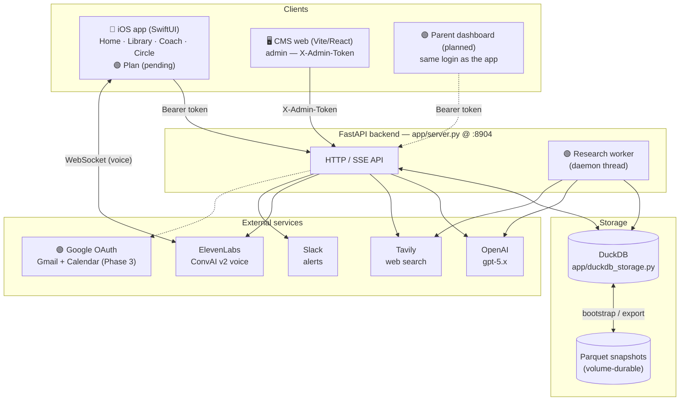
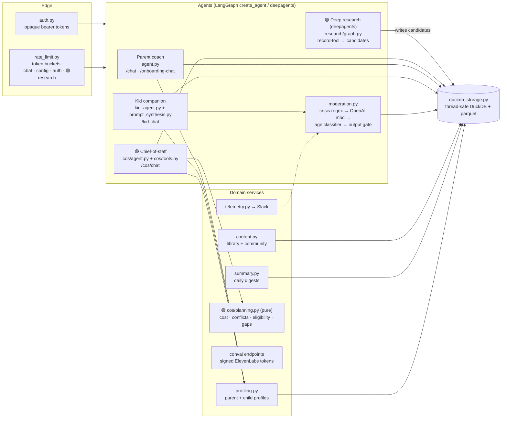
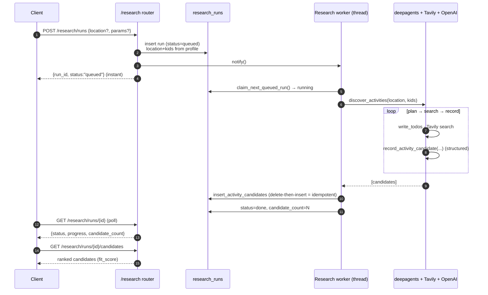
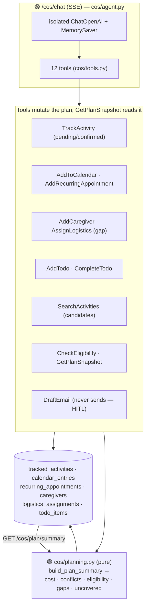
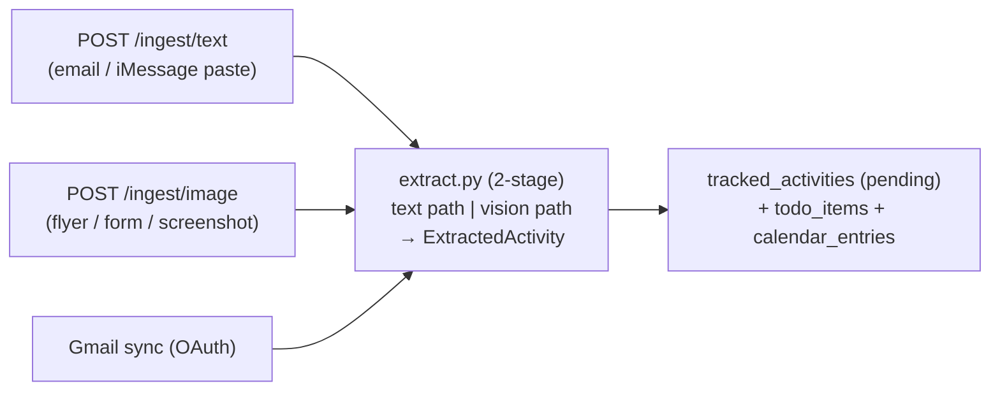
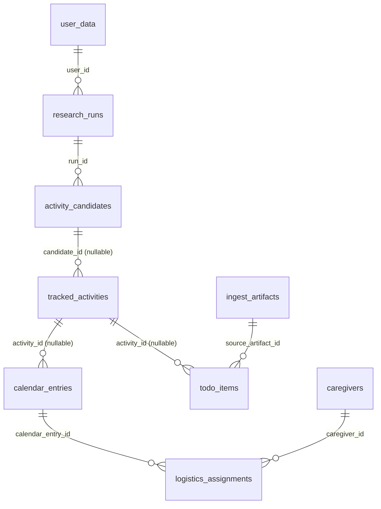

# MVP — System Architecture

A parenting app with four AI agents (parent coach, kid companion, **chief-of-staff**,
and a **deep-research** background agent), a content library, and ElevenLabs voice.
Backend is FastAPI + LangGraph + DuckDB; clients are a SwiftUI iOS app and React web apps.

> **Legend:** 🟢 = activity-planning / chief-of-staff capability (newest, branch
> `feat/activity-planning-chief-of-staff`). Everything else is shipped.

---

## 1. System context



---

## 2. Backend internals — agents, services, storage



**Agent isolation:** the coach, kid, and chief-of-staff agents each have their **own**
`ChatOpenAI`, checkpointer, and per-user cache — no shared state, so a regression in one
can't affect the others. The research agent is `deepagents` (planning + sub-agents +
filesystem harness) with an explicit OpenAI model (deepagents defaults to Anthropic).

---

## 3. 🟢 Activity-planning capability (the new flow)

Two cooperating pieces: a **background research agent** that discovers activities, and an
interactive **chief-of-staff** agent that turns discoveries into a coordinated plan.

### 3a. Discovery — research run lifecycle (async, poll-based)



Durability: the `research_runs` row **is** the job (the phone never holds it). On restart a
startup sweeper re-queues anything left `running`; re-runs are idempotent.

### 3b. Coordination — chief-of-staff



`GET /cos/plan/summary` returns the workbook's derived intelligence: running **cost** tally
(confirmed vs TBD), **time conflicts** (camp hours vs therapy), **age-eligibility** flags,
caregiver **coverage gaps**, and **uncovered weeks**.

### 3c. (Phase 3, planned) Multimodal ingestion → plan



---

## 4. Data model (DuckDB)

All tables bootstrap from parquet snapshots on startup and export back on writes/shutdown.
User-state parquets are excluded from the Docker build context (prod keeps its own volume copy).



| Domain | Tables |
|---|---|
| Core / auth | `user_data`, `auth_tokens`, `consent_records`, `audit_events` |
| Content | `categories`, `articles`, `community_posts`, `post_replies` |
| Kid companion | `kid_agent_configs`, `kid_messages`, `kid_credentials`, `moderation_events`, `kid_agent_crisis_locks`, `daily_summaries` |
| 🟢 Discovery | `research_runs`, `activity_candidates` |
| 🟢 Coordination | `tracked_activities`, `calendar_entries`, `recurring_appointments`, `caregivers`, `logistics_assignments`, `todo_items`, `cos_messages` |
| 🟢 Ingestion (Phase 3) | `ingest_artifacts`, `google_oauth_tokens` |

---

## 5. Cross-cutting

- **Auth:** opaque bearer tokens (`/auth/issue-token`), hashed at rest; `authorize_user_match`
  blocks cross-user access on every write.
- **Rate limiting:** in-process token buckets per `(user, class)` — `chat`, `config`, `auth`,
  🟢`research` (runs are expensive → 20/hr).
- **Moderation (kid only):** deterministic crisis regex → OpenAI moderation → age classifier →
  streaming output gate; crisis trips a persistent lock until a parent revives it.
- **Streaming:** SSE everywhere a model streams (`/chat`, `/kid-chat`, 🟢`/cos/chat`) —
  `data: {"type":"token","content":...}` … `data: [DONE]`.
- **Voice:** ElevenLabs **ConvAI v2** only (v1 per-fragment TTS removed); backend issues signed
  WebSocket tokens, the client connects to ElevenLabs directly.
- **Concurrency:** one DuckDB connection behind an RLock (`_ThreadSafeConn`); the research
  worker and request threads serialize through it.

---

## 6. Stack

| Layer | Tech |
|---|---|
| iOS | SwiftUI, MarkdownUI, Hearth design system (Fraunces/Inter/JetBrains Mono) |
| Web | Vite 8 · React 19 · TS · Tailwind 4 (CMS today; 🟢 parent dashboard planned) |
| Backend | FastAPI · LangGraph 1.2 · LangChain 1.3 · 🟢 deepagents 0.6 · DuckDB |
| Models | OpenAI gpt-5.x (agents · moderation · synthesis · 🟢 research/extraction) |
| Search | Tavily (coach 2 results; 🟢 research 8, advanced depth) |
| Voice | ElevenLabs ConvAI v2 |
| Deploy | Railway (single instance, mounted volume for DuckDB + parquet) |
```
